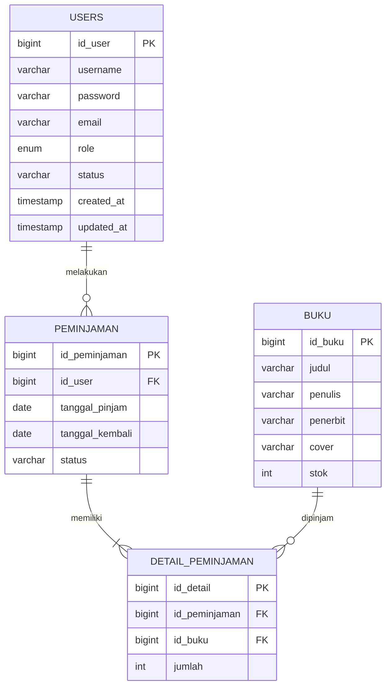
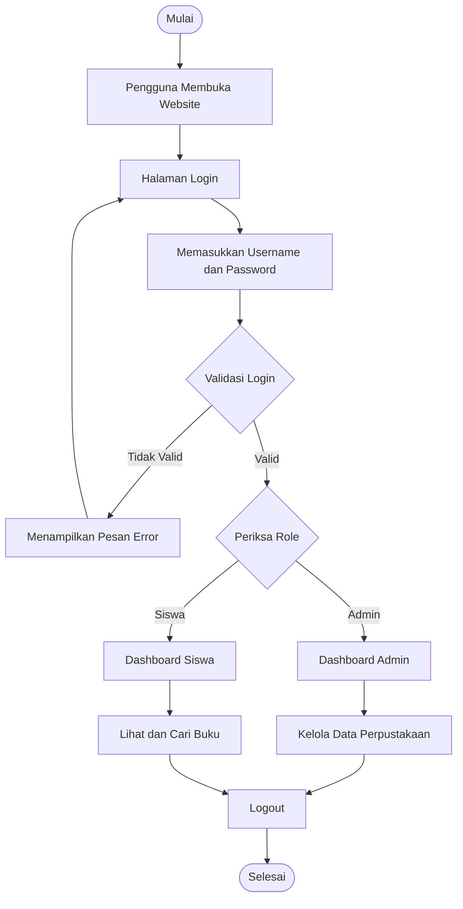
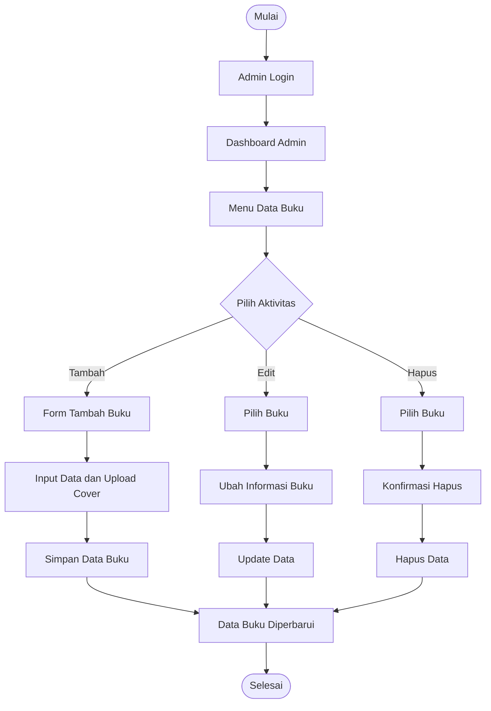

# 📚 SISTEM INFORMASI PERPUSTAKAAN
### UKK VALENTD — Aplikasi Pengelolaan Perpustakaan Berbasis Web

<p align="center">
  
  
  
  
</p>

<p align="center">
  <b>Website Sistem Informasi Perpustakaan</b><br>
  Project Uji Kompetensi Keahlian (UKK)
</p>

---

## 🌐 1. Informasi Website

| Keterangan | Detail |
|---|---|
| Nama Project | Sistem Informasi Perpustakaan |
| Nama Repository | UKK_Valentd |
| Developer | Valent |
| Jenis Project | Website Application |
| Framework | Laravel 10 |
| Bahasa Pemrograman | PHP |
| Database | MySQL |
| Platform | Web |
| Hosting Demo | GitHub Pages |
| Tujuan | Uji Kompetensi Keahlian (UKK) |

**Link Website:**

🔗 https://valentpplg-bit.github.io/UKK_Valentd/

**Link Repository GitHub:**

🔗 https://github.com/valentpplg-bit/UKK_Valentd

---

## 📖 2. Deskripsi Project

Sistem Informasi Perpustakaan merupakan aplikasi berbasis web yang dirancang untuk membantu proses pengelolaan data perpustakaan secara lebih efektif, terstruktur, dan terkomputerisasi.

Aplikasi ini bertujuan untuk mempermudah pengelolaan informasi buku, data pengguna, serta aktivitas perpustakaan melalui satu sistem yang dapat diakses menggunakan browser.

Dengan adanya aplikasi ini, proses pengelolaan perpustakaan diharapkan menjadi lebih cepat, akurat, dan mengurangi kesalahan dalam pencatatan data secara manual.

Project ini dikembangkan menggunakan framework Laravel 10 dengan bahasa pemrograman PHP serta database MySQL.

## 🎯 3. Tujuan Pembuatan

Tujuan pengembangan aplikasi ini adalah:

1. Membuat sistem informasi perpustakaan berbasis website.
2. Mempermudah pengelolaan data buku.
3. Mempermudah pengelolaan akun pengguna.
4. Membantu proses pencarian informasi buku.
5. Mengurangi penggunaan pencatatan data secara manual.
6. Menerapkan kemampuan pemrograman web dalam proyek UKK.
7. Mengimplementasikan database relasional menggunakan MySQL.

---

## ✨ 4. Fitur Aplikasi

### 👨‍💼 A. Fitur Admin

Admin memiliki hak akses untuk mengelola informasi dan data perpustakaan.

- Login admin.
- Dashboard admin.
- Mengelola data buku.
- Menambahkan data buku.
- Mengedit data buku.
- Menghapus data buku.
- Mengunggah cover buku.
- Mengelola data pengguna.
- Melihat informasi data perpustakaan.

### 👨‍🎓 B. Fitur Siswa

Siswa merupakan pengguna yang dapat mengakses informasi perpustakaan.

- Login siswa.
- Melihat informasi buku.
- Melihat daftar buku.
- Mencari buku.
- Melihat detail informasi buku.

*Catatan: Sesuaikan daftar fitur ini dengan fitur yang benar-benar sudah tersedia di aplikasi.*

---

## 🛠️ 5. Teknologi yang Digunakan

| Teknologi | Kegunaan |
|---|---|
| HTML5 | Membuat struktur halaman website |
| CSS3 | Mengatur tampilan website |
| Bootstrap | Membantu desain antarmuka |
| JavaScript | Membuat interaksi halaman |
| PHP | Bahasa pemrograman backend |
| Laravel 10 | Framework pengembangan aplikasi |
| MySQL | Menyimpan data aplikasi |
| Composer | Mengelola dependency PHP |
| Git | Mengelola versi project |
| GitHub | Menyimpan source code |

---

## 🗂️ 6. Struktur Project

Berikut merupakan gambaran struktur folder Laravel 10:

```text
UKK_Valentd/
│
├── app/
│   ├── Http/
│   │   ├── Controllers/
│   │   └── Middleware/
│   │
│   └── Models/
│
├── bootstrap/
│
├── config/
│
├── database/
│   ├── migrations/
│   └── seeders/
│
├── public/
│   ├── css/
│   ├── js/
│   └── images/
│
├── resources/
│   └── views/
│       ├── layouts/
│       ├── auth/
│       ├── buku/
│       └── dashboard/
│
├── routes/
│   └── web.php
│
├── storage/
│
├── tests/
│
├── .env.example
├── artisan
├── composer.json
└── README.md
```

---

## 🗄️ 7. Entity Relationship Diagram (ERD)

ERD merupakan diagram yang menggambarkan hubungan antarentitas dalam database aplikasi.

Berikut adalah rancangan ERD konseptual untuk Sistem Informasi Perpustakaan.



### Penjelasan Entitas

| Entitas | Keterangan |
|---|---|
| USERS | Menyimpan data akun admin dan siswa |
| BUKU | Menyimpan informasi koleksi buku |
| PEMINJAMAN | Menyimpan transaksi peminjaman |
| DETAIL_PEMINJAMAN | Menyimpan rincian buku dalam transaksi |

### Relasi Database

1. Satu user dapat memiliki banyak transaksi peminjaman.
2. Satu transaksi peminjaman dapat memiliki beberapa detail buku.
3. Satu buku dapat muncul pada banyak detail peminjaman.
4. Setiap transaksi peminjaman terhubung dengan satu user.

**Penting:** Diagram ini merupakan rancangan konseptual yang mencakup kemungkinan modul peminjaman. Tabel peminjaman dan detail_peminjaman belum dikonfirmasi sebagai tabel yang benar-benar ada dalam database project. Sesuaikan diagram dan kolomnya dengan migration Laravel yang digunakan.

---

## 🔄 8. Flowchart Sistem

Flowchart menggambarkan alur kerja aplikasi dari pengguna membuka website hingga menjalankan fitur sesuai hak aksesnya.

### A. Flowchart Login dan Hak Akses



### B. Flowchart Pengelolaan Data Buku



---

## 💻 9. Instalasi Project

Berikut langkah-langkah untuk menjalankan project secara lokal.

### Persyaratan

Pastikan perangkat sudah memiliki:

- PHP versi 8.1 atau yang kompatibel dengan Laravel 10.
- Composer.
- MySQL.
- Web server lokal seperti Laragon atau XAMPP.
- Git.

### Langkah 1 — Clone Repository

Buka terminal atau CMD, kemudian jalankan:

```bash
git clone https://github.com/valentpplg-bit/UKK_Valentd.git
```

Masuk ke folder project:

```bash
cd UKK_Valentd
```

### Langkah 2 — Install Dependency

```bash
composer install
```

### Langkah 3 — Konfigurasi Environment

Salin file `.env.example` menjadi `.env`.

```bash
copy .env.example .env
```

Kemudian buat application key:

```bash
php artisan key:generate
```

### Langkah 4 — Konfigurasi Database

Buat database baru melalui phpMyAdmin.

Contoh nama database:

```text
perpustakaan
```

Sesuaikan konfigurasi berikut di file `.env`:

```env
APP_NAME=Perpustakaan
APP_ENV=local
APP_DEBUG=true
APP_URL=http://127.0.0.1:8000

DB_CONNECTION=mysql
DB_HOST=127.0.0.1
DB_PORT=3306
DB_DATABASE=perpustakaan
DB_USERNAME=root
DB_PASSWORD=
```

### Langkah 5 — Migrasi Database

Jalankan:

```bash
php artisan migrate
```

Jika database sudah berisi data penting, jangan menggunakan `migrate:fresh` karena perintah tersebut dapat menghapus seluruh tabel.

### Langkah 6 — Menjalankan Website

```bash
php artisan serve
```

Buka browser:

```text
http://127.0.0.1:8000
```

---

## 📸 10. Dokumentasi Tampilan Aplikasi

Bagian ini dapat digunakan untuk menampilkan screenshot aplikasi.

### Halaman Login

Tambahkan screenshot halaman login di sini.

```text

```

### Dashboard Admin

```text

```

### Halaman Data Buku

```text

```

### Halaman Tambah Buku

```text

```

### Halaman Data Pengguna

```text

```

*Untuk menampilkan gambar di GitHub, simpan screenshot pada folder `screenshots` di repository.*

---

## 🔐 11. Keamanan Sistem

Beberapa aspek keamanan yang perlu diterapkan dalam aplikasi:

- Autentikasi pengguna menggunakan Laravel.
- Pembatasan akses berdasarkan role pengguna.
- Validasi input pada formulir.
- Proteksi CSRF.
- Password disimpan menggunakan hashing.
- Validasi file gambar yang diunggah.
- Pengaturan konfigurasi database melalui `.env`.
- Tidak mengunggah file `.env` yang berisi kredensial rahasia ke GitHub.

---

## 🧪 12. Pengujian Sistem

Pengujian dilakukan untuk memastikan fitur aplikasi berjalan sesuai kebutuhan.

| No. | Pengujian | Hasil yang Diharapkan |
|---|---|---|
| 1 | Login dengan akun valid | Berhasil masuk |
| 2 | Login dengan akun tidak valid | Muncul pesan error |
| 3 | Menambahkan buku | Data berhasil disimpan |
| 4 | Mengedit buku | Data berhasil diperbarui |
| 5 | Menghapus buku | Data berhasil dihapus |
| 6 | Upload cover buku | Gambar berhasil tersimpan |
| 7 | Melihat daftar buku | Data buku ditampilkan |
| 8 | Logout | Pengguna keluar dari sistem |

---

## 🚀 13. Pengembangan Selanjutnya

Beberapa pengembangan yang dapat dilakukan:

- Menambahkan fitur peminjaman buku.
- Menambahkan fitur pengembalian buku.
- Menambahkan pencatatan riwayat transaksi.
- Menambahkan laporan perpustakaan.
- Menambahkan pencarian dan filter buku.
- Menambahkan notifikasi keterlambatan pengembalian.
- Mengembangkan tampilan agar lebih responsif.

---

## 👨‍💻 14. Developer

**Nama:** Valent  
**Project:** UKK Sistem Informasi Perpustakaan  
**Repository:** UKK_Valentd

Project ini dibuat sebagai implementasi keterampilan dalam bidang Pengembangan Perangkat Lunak dan Gim (PPLG), khususnya pengembangan aplikasi berbasis web menggunakan Laravel.

---

## 📄 15. Lisensi

Project ini dikembangkan untuk keperluan pendidikan, pembelajaran, portofolio, dan Uji Kompetensi Keahlian (UKK).

---

<p align="center">
  <b>© 2026 UKK VALENTD</b><br>
  Sistem Informasi Perpustakaan Berbasis Web
  <br><br>
  <i>Built with Laravel ❤️</i>
</p>

<p align="center"><a href="https://laravel.com" target="_blank"></a></p>

<p align="center">
<a href="https://github.com/laravel/framework/actions"></a>
<a href="https://packagist.org/packages/laravel/framework"></a>
<a href="https://packagist.org/packages/laravel/framework"></a>
<a href="https://packagist.org/packages/laravel/framework"></a>
</p>

## About Laravel

Laravel is a web application framework with expressive, elegant syntax. We believe development must be an enjoyable and creative experience to be truly fulfilling. Laravel takes the pain out of development by easing common tasks used in many web projects, such as:

- [Simple, fast routing engine](https://laravel.com/docs/routing).
- [Powerful dependency injection container](https://laravel.com/docs/container).
- Multiple back-ends for [session](https://laravel.com/docs/session) and [cache](https://laravel.com/docs/cache) storage.
- Expressive, intuitive [database ORM](https://laravel.com/docs/eloquent).
- Database agnostic [schema migrations](https://laravel.com/docs/migrations).
- [Robust background job processing](https://laravel.com/docs/queues).
- [Real-time event broadcasting](https://laravel.com/docs/broadcasting).

Laravel is accessible, powerful, and provides tools required for large, robust applications.

## Learning Laravel

Laravel has the most extensive and thorough [documentation](https://laravel.com/docs) and video tutorial library of all modern web application frameworks, making it a breeze to get started with the framework.

You may also try the [Laravel Bootcamp](https://bootcamp.laravel.com), where you will be guided through building a modern Laravel application from scratch.

If you don't feel like reading, [Laracasts](https://laracasts.com) can help. Laracasts contains thousands of video tutorials on a range of topics including Laravel, modern PHP, unit testing, and JavaScript. Boost your skills by digging into our comprehensive video library.

## Laravel Sponsors

We would like to extend our thanks to the following sponsors for funding Laravel development. If you are interested in becoming a sponsor, please visit the [Laravel Partners program](https://partners.laravel.com).

### Premium Partners

- **[Vehikl](https://vehikl.com/)**
- **[Tighten Co.](https://tighten.co)**
- **[WebReinvent](https://webreinvent.com/)**
- **[Kirschbaum Development Group](https://kirschbaumdevelopment.com)**
- **[64 Robots](https://64robots.com)**
- **[Curotec](https://www.curotec.com/services/technologies/laravel/)**
- **[Cyber-Duck](https://cyber-duck.co.uk)**
- **[DevSquad](https://devsquad.com/hire-laravel-developers)**
- **[Jump24](https://jump24.co.uk)**
- **[Redberry](https://redberry.international/laravel/)**
- **[Active Logic](https://activelogic.com)**
- **[byte5](https://byte5.de)**
- **[OP.GG](https://op.gg)**

## Contributing

Thank you for considering contributing to the Laravel framework! The contribution guide can be found in the [Laravel documentation](https://laravel.com/docs/contributions).

## Code of Conduct

In order to ensure that the Laravel community is welcoming to all, please review and abide by the [Code of Conduct](https://laravel.com/docs/contributions#code-of-conduct).

## Security Vulnerabilities

If you discover a security vulnerability within Laravel, please send an e-mail to Taylor Otwell via [taylor@laravel.com](mailto:taylor@laravel.com). All security vulnerabilities will be promptly addressed.

## License

The Laravel framework is open-sourced software licensed under the [MIT license](https://opensource.org/licenses/MIT).
